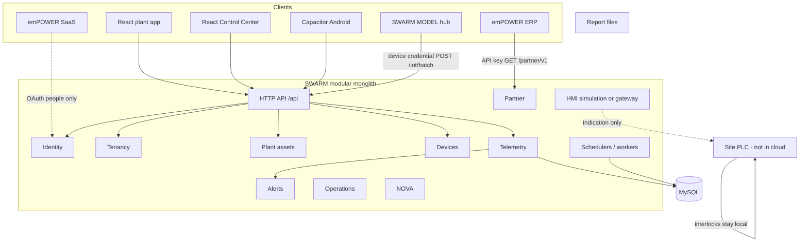

# PURPOSE: Operator/developer documentation for SWARM.
# 06 — Target system architecture

## Decision

**Retain and evolve the React + Spring Boot + MySQL modular monolith.**

Justified by this repository:

- One product, one team, tens-to-low-hundreds of plants, not millions of devices.
- Pi-primary + Railway standby already works as an operations model.
- The pain is **boundaries, security, and unfinished modules**, not JVM throughput.
- Microservices would split ingest, HMI, and NOVA across networks the Pi cannot afford.

Extract a service later only when a boundary has independent scale or failure (ingest fan-in, report workers). See ADR-001.

## Logical view



## Module boundaries (packages)

Target Java packages under `com.swarm` **or** keep `com.biopower` until a dedicated rename slice (ADR-003). Logical modules:

| Module | May depend on | Must not depend on |
|---|---|---|
| `identity` | — | telemetry, hmi |
| `tenancy` | identity | hmi, nova |
| `assets` | tenancy | nova, partner |
| `devices` | assets, tenancy | nova |
| `telemetry` | devices, assets | hmi command, nova |
| `alerts` | telemetry, assets | nova |
| `hmi` | assets, telemetry (read) | partner |
| `ops` | assets | devices ingest |
| `nova` | all **read** facades | ingest, hmi command |
| `partner` | telemetry read, tenancy | hmi, users |
| `controlcenter` | tenancy, identity | telemetry write, hmi command |
| `platform` | logging, clock, files | domain |

Dependency rule: **NOVA and Partner are read-only consumers.** Ingest never calls NOVA. HMI commands never go through NOVA.

## API conventions

- Context path remains `/api`.
- JSON envelopes: keep `{ success, message, data }` for the SPA; Partner v1 stays a **flat** resource JSON for emPOWER compatibility.
- Errors: `code`, `message`, `details`; no stack traces to clients.
- Idempotency-Key on ingest and report generate.
- Version Partner as `/partner/v1`; plant SPA APIs stay unversioned until a breaking change, then `/v2`.

## Background processing

Today: `@Scheduled` in the web process (alerts timeout 5 min, HMI auto-sequence 3 s, retention 02:30).

2.0:

- Keep schedulers in-process on **primary** only (`SWARM_DEPLOYMENT_ROLE=primary` already gates Nova and should gate HMI sequence + retention).
- Add a **job table** for report generation (status QUEUED/RUNNING/DONE/FAILED).
- Do not add Kafka. Use MySQL as queue until volume hurts.

## Events (in-process)

`TelemetryAccepted` → alert evaluate, AI health debounce, cache evict. Spring `ApplicationEvent` is enough. No event bus product.

## Real-time distribution

Today: HTTP poll (dashboard, HMI 4 s).

2.0 phase 1: keep polling.  
2.0 phase 2: SSE `/api/stream/plants/{id}` for readings/alerts when poll load is a problem. WebSockets optional. Android uses the same SSE.

## Caching

- Plant ACL set on the principal (already in JWT-ish plantIds — **must refresh** on assignment change; today JWT is 24 h stale). Short-lived access token + server session/revocation (09).
- Latest reading per node: memory cache with ingest invalidation.
- No Redis required on the Pi.

## File / report storage

- Local disk on Pi (`/var/swarm/reports`) with backup rsync; or S3-compatible later.
- DB stores metadata + checksum + plant_id.
- Nginx never serves the directory publicly; API streams with auth.

## Observability

- `/health` stays public liveness (already returns `identityMode`, `deploymentRole`).
- Add `/health/ready` (DB, disk) — **not public** or token-gated.
- Structured logs: `companyId`, `plantId`, `requestId`. Never log tokens, device passwords, or raw API keys.
- Metrics: ingest rate, 4xx/5xx, alert evaluate time, partner 401s.

## Configuration

- Env vars remain the 12-factor source (`application.yml` placeholders).
- `system_settings` today is a UI that **does not drive** MQTT/mail/AI. Either wire it or remove those tabs. 2.0: settings that affect runtime are env + audited `plant_settings` / `alert_policies` tables.

## Deployment topology

Keep:

```
ESP (LAN) → Cloudflare Tunnel → Pi nginx → Spring → MySQL
App users → app.swarm.co.in → Pi
Standby API → Railway (read replica / promoted)
```

See 22. No Kubernetes in 2.0.

## Backup and DR

- Existing Pi → Railway MySQL sync must be treated as **the** DR path.
- Daily logical dump + retain readings per `SENSOR_RETENTION_DAYS` (default 30 — too short for production claims; make plant-configurable, default 400 days for daily aggs, 90 days for raw if disk allows).
- Restore drill documented; architecture does not invent a new cloud.

## What is not in the cloud box

Site PLC, hardwired E-stop, gas detector trips, compressor local panels. SWARM may **show** status. It may **request** a command. It must not **be** the interlock.
