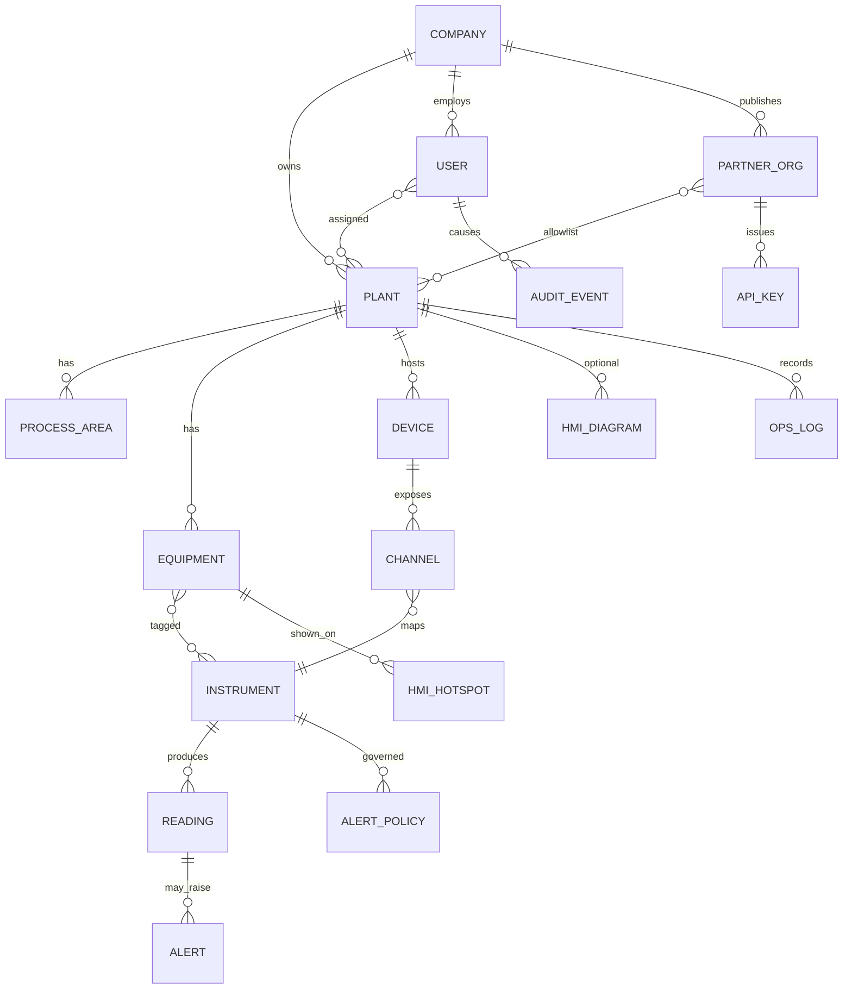

# PURPOSE: Operator/developer documentation for SWARM.
# 08 — Database architecture

## Exists today

MySQL 8, Hibernate `ddl-auto: update`, `database/schema.sql` as Docker init. No versioned migrations.

### Current tables (confirmed)

`companies`, `users`, `user_plants`, `user_sensor_nodes` (JPA), `plants`, `sensor_nodes`, `sensor_readings`, `alerts`, `ai_recommendations`, `predictive_maintenance`, `reports`, `system_settings`, `partner_organizations`, `partner_org_plants`, `partner_api_keys`, `hmi_equipment`, `hmi_equipment_state`, `hmi_plant_state`, `nova_threads`, `nova_messages`.

`sensor_readings` is denormalized (`plant_id`, `node_id`, `sensor_type`, `value`, `recorded_at`) with indexes `(plant_id, recorded_at)` and `(node_id, recorded_at)`. No quality column. No unique (node, recorded_at).

## Strategy

1. **Introduce Flyway** immediately (ADR-002). Baseline existing schema as `V1__baseline`.
2. Set `ddl-auto: validate` after baseline.
3. Additive migrations only until a planned expand/contract (24).
4. Stay on MySQL. Daily aggregates can be a table, not Timescale, at this scale.

## Target ER (logical)



## New / evolved tables (additive)

| Table | Purpose |
|---|---|
| `flyway_schema_history` | Migrations |
| `process_areas` | `plant_id`, `area_code`, `enabled`, `name` |
| `equipment` | `plant_id`, `area_id`, `tag`, `kind`, `name` |
| `devices` | `plant_id`, `kind` (ESP_HUB/PLC/MQTT/GATEWAY), `chip_id` unique, `fw_version`, `status` |
| `device_credentials` | hashed secret, rotated_at, expires |
| `channels` | device_id, instrument_id, sensor_type (compat) |
| `instruments` | start as view/compat over `sensor_nodes` then table |
| `readings` quality columns on `sensor_readings`: `quality`, `source_kind`, `ingest_id` |
| `alert_policies` | plant/instrument thresholds, versioned |
| `audit_events` | actor, action, entity, diff, ip |
| `auth_sessions` / `refresh_tokens` | revocation |
| `hmi_commands` | command lifecycle |
| `commissioning_records` | simulation vs live |
| `ops_logs`, `feedstock_tickets`, `downtime_events`, `work_orders` | module I |
| `report_files` | checksum, storage_key |
| `daily_aggregates` | persist what Partner already computes on the fly |

Keep `sensor_nodes` until Partner and the SPA are migrated. Add `device_id` FK nullable.

## Reading row (target)

```
id, plant_id, instrument_id, node_id (compat),
metric_type, value, unit,
recorded_at (UTC), received_at (UTC),
quality (MEASURED|ESTIMATED|BAD|STALE|INCOMPLETE),
source_kind (MEASURED|CALCULATED|OPERATOR|AI_ESTIMATE),
device_id, ingest_id
```

Unique: `(instrument_id, recorded_at, ingest_id)` or `(node_id, recorded_at)` where ingest_id present.

## Indexes

- Existing plant/node + time stay.
- `(plant_id, recorded_at)` covering dashboard.
- `(device_id, recorded_at)` for hub diagnostics.
- `audit_events (company_id, created_at)`.

## Retention

`DataRetentionScheduler` already deletes raw readings, old AI recs, Nova threads.

| Data | Default 2.0 | Notes |
|---|---|---|
| Raw readings | 90 days (was 30) | Configurable per plant |
| Daily aggregates | 5 years | Small |
| Alerts | 2 years | |
| Audit | 2 years | |
| Reports | 2 years | Files + row |
| Nova messages | 90 days | keep |

Never zero-fill gaps. Partner already uses `INCOMPLETE`.

## Time

Store UTC `Instant`/`TIMESTAMP`. Plant `timezone` column (new, default `Asia/Kolkata` or explicit). Analytics “daily” uses plant zone only at query time.

## What not to do

- Do not move ingest to Mongo “for IoT”.
- Do not add Timescale until a measured query problem exists.
- Do not put JSON blobs as the only store for equipment; tags must be queryable.
