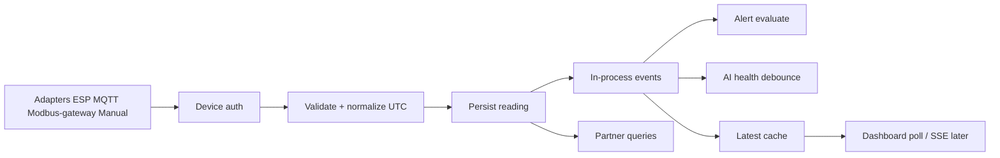

# PURPOSE: Operator/developer documentation for SWARM.
# 14 — Telemetry architecture

## Exists today

```
ESP --30s HTTP--> POST /api/iot/batch (permitAll)
MQTT optional --> MqttConfig --> IoTDataService.ingestData
pair/sync --> DeviceService.syncReadings
              --> persist sensor_readings
              --> last_reading_at, device_ip, signal
              --> AlertService.evaluateReading
              --> AiHealthService.analyzePlant
```

No idempotency, quality, or device auth. Retention cron deletes old rows.

## Target pipeline



## Adapters

One interface:

```java
public interface TelemetryAdapter {
  IngestResult ingest(IngestEnvelope envelope, DevicePrincipal device);
}
```

HTTP and MQTT both produce `IngestEnvelope`. PLC never talks to the cloud directly; a site gateway uses HTTP/MQTT.

## Validation

1. Auth device ↔ chip ↔ plant.
2. Each point: node belongs to plant and device (or mapped instrument).
3. `sensorType` matches registration (already enforced).
4. Timestamp: if missing, `received_at`. If > 10 min future, reject. If > retention in the past, reject or store as historical with flag.
5. Range check.
6. Idempotency-Key or `(nodeId, recordedAt)` unique → 200 duplicate, no second alert.

## Storage

MySQL `sensor_readings` + quality columns. Hot path is latest-per-node query (dashboard). History is indexed time range (analytics, Partner history).

Daily aggregates: materialize with a primary-only hourly job (Partner currently aggregates on read — expensive). Table `daily_aggregates(plant_id, node_id, metric, day_utc, min, max, avg, count, quality)`.

## Distribution

- Phase 1: poll (keep).
- Phase 2: SSE for users with `plant.read`.
- Partner remains pull (~15 min). No webhook until keys/scopes are solid (existing contract: webhooks deferred).

## Clock

Hubs have poor clocks. Prefer hub timestamp if sane; else server `received_at` and `quality` note `CLOCK_INFERRED`. Document this on MQ5/DHT batches.

## Backpressure

If DB write latency rises, return 503 to hub (it retries next 30 s). Do not drop without 5xx. Rate limit floods.

## Compatibility

Keep batch JSON `{ plantId, readings: [{ nodeId, sensorType, value }] }` as used by firmware. Additive `chipId`, `recordedAt`. Firmware update slice sends credential header.

## What not to build

- Kafka, Flink, Timescale “historian” product.
- Cloud-to-device command bus mixed into ingest (commands are HMI module).
