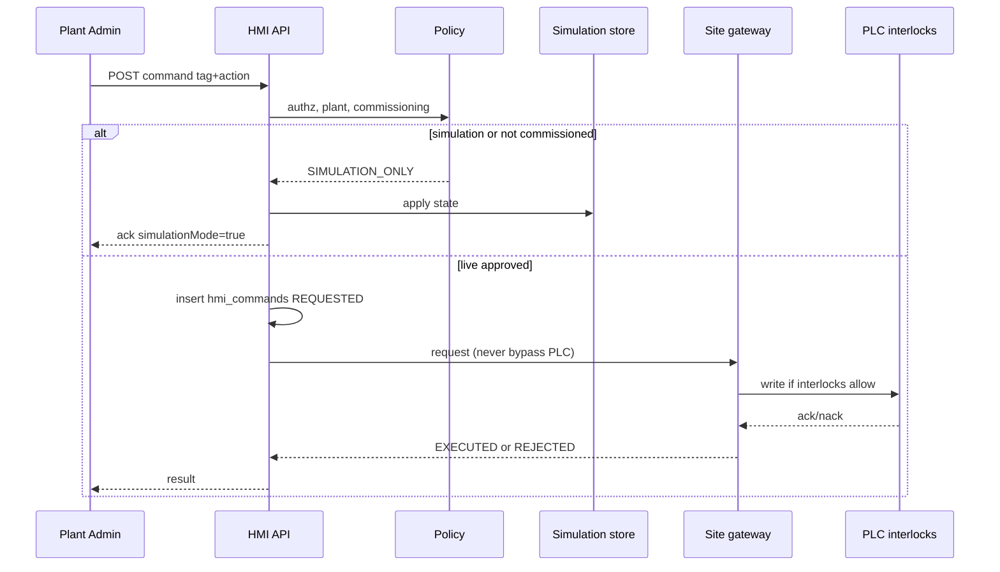

# PURPOSE: Operator/developer documentation for SWARM.
# 15 — HMI and command lifecycle

## Exists today

- Control Center `hmi_enabled`.
- Extra gate: feedstock contains `P&ID` or name contains `biomethanation`.
- iframe PFD `biogas-pfd.html` + `swarm-hmi.js`.
- `GET /hmi/{id}/state` always `simulationMode: true`.
- Commands: POWER_ON/OFF, START/STOP per tag; master PLANT_POWER_*, AUTO_SEQUENCE_*.
- State in MySQL; auto-sequence `@Scheduled` 3 s on primary.
- Live **numbers** from linked `sensor_node_id`.
- Frontend audit: `sessionStorage` 50 entries — not a record.
- Unused React SVG/Tata overlays.

## Target lifecycle

## Command record

`hmi_commands`: id, plant_id, actor_id, tag, action, mode (SIM/LIVE), status (REQUESTED, SENT, ACKED, REJECTED, FAILED, CANCELLED), reason, created_at, completed_at, correlation_id.

**Acceptance:** every START/STOP from UI appears here. The iframe must not be the system of record.

## Authorization

| Mode | Who |
|---|---|
| View | Any plant user if `hmi_enabled` |
| SIM command | SUPER_ADMIN, PLANT_ADMIN |
| LIVE command | Same + `commissioning_records.status=LIVE_APPROVED` + step-up MFA + `hmi.command.live` |
| Operator | View only (keep) |

## Diagram packs

- Default: current biomethanation PFD (retain).
- Future: plant-specific HTML/SVG **pack id** on `plants.hmi_pack`.
- Do not resurrect Tata overlays as the live path unless a customer plant is that P&ID.

## Polling

Keep 4 s poll until SSE. State DTO adds `simulationMode`, `commissioningStatus`, `serverTime`.

## Auto-sequence

Keep as **simulation training** only. No live auto-sequence from the cloud. UI button currently missing (`PlantMasterControls` unused) — if shown, label “Simulation sequence”.

## Failure handling

- Gateway timeout: command FAILED, equipment state unchanged.
- PLC nack: REJECTED with interlock message if the gateway provides one.
- User never sees “running” unless ACKED.

## Cleanup slice

Quarantine unused `components/hmi/*` not imported by `PlantHmi.jsx`. Reduces the chance of shipping two HMIs.
